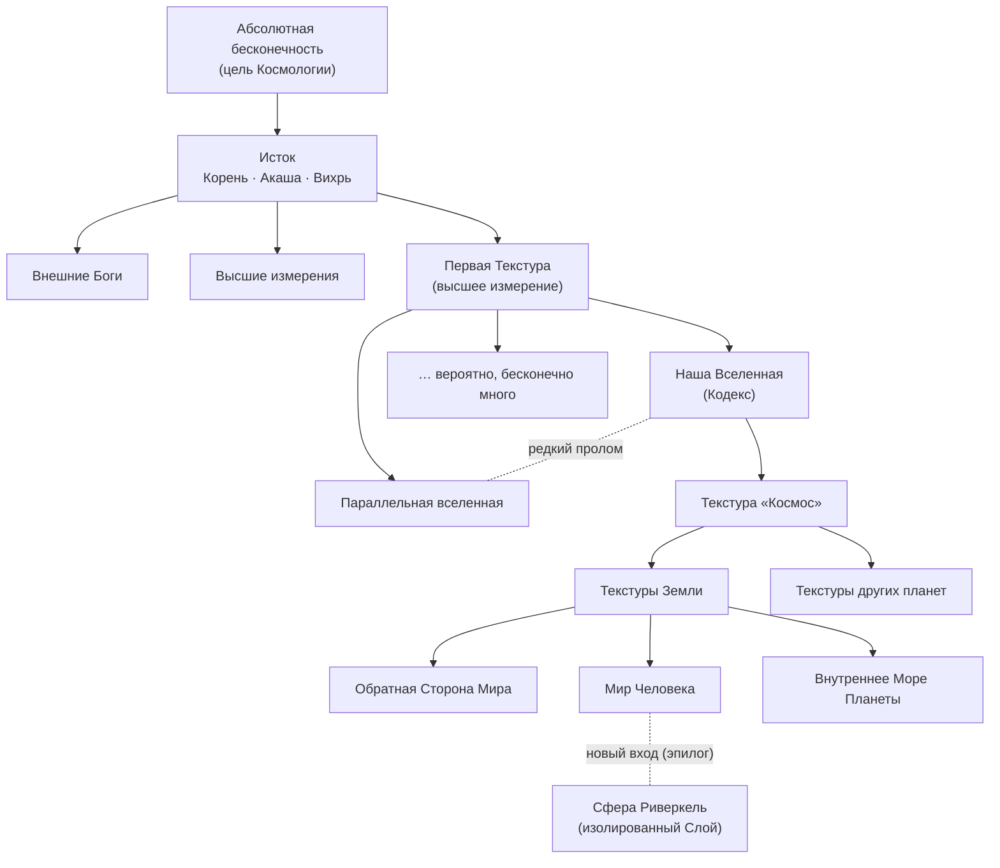

---
tags:
  - космология
status: В работе
---

# Структура мироздания

> [!info] Источник
> Тетрадь мастера, стр. 29–34 ([[Космология - тетрадь (расшифровка)]]), и ответы мастера (шаг 2 [[Космология - план работы|плана]]). Термины — [[Космология - глоссарий]], об Истоке подробно — [[Исток]].
> Что помечено — добавлено Claude и ждёт решения мастера.

## Схема
Подробная схема — canvas [[Структура мироздания - схема.canvas|Структура мироздания — схема]]. Кратко:

Кольца вокруг Земли, от центра наружу: **Земля → Обратная Сторона Мира → Мир Человека → Космос** (стикер на стр. 29).

## Уровни
### Абсолютная бесконечность
Последний из возможных планов. Всё существующее — его подмножество. Недоступный кардинал, истинная абстракция небытия, которую нельзя описать языком. Её изучает наука **Космология** (стр. 34).

### Исток
По словам мастера, это «до безобразия абстрактная текстура», и Текстура нашей Вселенной вложена в неё на множество степеней вложенности. Внешние Боги и высшие измерения — тоже его часть (стр. 32). Подробно — [[Исток]].

### Внешние Боги и высшие измерения
Высшие измерения — измерения уровня Первой Текстуры и выше. Внешние Боги — высшие многомерные существа, не подчиняются законам и здравому смыслу (стр. 32). Живут **прямо на плане Первой Текстуры**, в духе мифологии Лавкрафта: чужды Земле, человечеству, физике и магии, питаются ужасом и безумием. Подробно — [[Высшие существа#Внешние Боги]].

### Первая Текстура и параллельные вселенные
**Первая Текстура** — имя собственное высшего измерения, подмножеством которого являются параллельные вселенные, и наша среди них (стр. 31). Если Вселенная — множество вещественных чисел, то Первая Текстура — множество комплексных.

**Параллельные вселенные:**
- Их число невозможно достоверно подсчитать. Скорее всего, их бесконечно много.
- Они далеко друг от друга, но при этом соседствуют.
- Их время и пространство связаны нестрого. **Цикл в каждой вселенной идёт со своей скоростью.**
- **Насколько они разные.** Одни отличаются от нашей совсем незначительно, другие — совершенно чужие миры.
- **Кто ходит между ними.** Высшие существа и Волшебники, достигшие Истока, например [[Тоуку Танзаки]].
- **Проломы.** При крайне редких условиях возможен прорыв сквозь вселенные: редкие аномалии и артефакты могут ненадолго соединить две вселенные. Через такое соединение проходит мана. Что пройдёт кроме неё, непредсказуемо: возможно, пролом передаст только магическую энергию и ничего больше.

### Наша Вселенная — Вселенная 403
Одно из измерений внутри Первой Текстуры — **Вселенная 403**. Внешние Боги называют её «Проектом» ([[Project 403 - Запрет]]). Её собственная Текстура объемлет все слои внутри неё. Высшие существа и Волшебники видят нашу Вселенную как книгу — **Кодекс**.

### Текстура «Космос»
Пространство со своими правилами бытия.
- Маги считают Космос отдельной Текстурой. Для обычных людей это просто часть бытия.
- Космос устроен так же, как Первая Текстура, только в меньшем масштабе. Первая Текстура объединяет параллельные вселенные, а Космос — Текстуры планет.
- **Текстуры планет — подмножества Текстуры Космоса.**

### Текстуры Земли
- **Обратная Сторона Мира** — ближайший к Земле слой. Здесь до сих пор действуют законы Эпохи Богов. Здесь живут божественные духи, мифические существа и фантазмальные виды. **Не подвержен Серости.** Людьми не изучен (стр. 30). Это изолированная вложенная Текстура, где ещё есть Истина. Поэтому, когда Исток покидает Вселенную, здесь связь с ним сохраняется (решение шага 3). Подробно — [[Обратная Сторона Мира]]: кто там живёт, демоны и дьяволы, пути внутрь, изоляция.
- **Внутреннее Море Планеты** — отдельная Текстура примерно в 2700 км под водой. Не прослойка в кольцах, а сосед: рядом с Текстурой Земли, проходит сквозь Обратную Сторону и касается Мира Человека. Особо изолирована: сдвинута по фазе до 6-го измерения. Подробно — [[Обратная Сторона Мира#Внутреннее Море Планеты]].
- **Мир Человека** (синоним — Человеческий мир). Слой, где живёт почти вся человеческая цивилизация. Работает по законам физики. Это материальный план большинства игр, и он проходит через Эпоху Серости (стр. 30).

## Иерархия: кто кого видит
- Каждое высшее измерение видит низшее как свиток или книгу (стр. 31–32).
- Существа высших измерений качественно превосходят низших.
- Низшие не способны видеть высших или взаимодействовать с ними. Они остаются во власти высших, даже если научатся смотреть на реальность глазами высших.

## Переходы между Текстурами
- **У каждой Текстуры есть вход и выход.** Перемещаться между Текстурами можно, если Текстура это позволяет.
- **Переход крайне сложен.**
- **Технологии.** Со временем человечество получает технологию перехода в Текстуру Космоса. Это двигает эры и эпохи вперёд и всё дальше уводит мир от Истины и Истока. Отсюда Эра космической колонизации и Эпоха Человека. Так же однажды люди научатся опускаться к Внутреннему Морю.
- **Сдвиг по фазе.** Обратная Сторона и Внутреннее Море сдвинуты по фазе до 6-го измерения шестимерного пространства. Без такого же сдвига до них не добраться, даже оказавшись на нужной глубине.
- **Волшебники** — те, кто познал Истину и достиг Истока. Они могут ходить даже между параллельными вселенными.
- **Маги** ищут пути в другие Текстуры и на Обратную Сторону Мира и постоянно пробуют новые способы. Одни Текстуры поддаются. Другие сильный маг может создать сам.
- **Изоляция.** Текстура может быть изолирована от других (стр. 29).

### Сфера Риверкель
- **Как возникла.** [[Тоуку Танзаки]] отрезал графство Риверкель от Кодекса, ограничил влияние Истока на него и сковал судьбы его жителей магической формулой ([[Размышления Тоуку Танзаки]]). Так появился отдельный Слой, созданный Волшебником.
- **Что изменилось в эпилоге.** Игроки с помощью артефакта частично обратили заклинание Танзаки вспять и создали новый вход между Миром Человека и Сферой Риверкель (в королевском лесу у реки Дардонье).
- **Что теперь.** Сфера осталась отдельным Слоем. Но через посредника — Мир Человека — она снова получила доступ к Истоку.

## Время
- В параллельных вселенных цикл идёт со своей скоростью, время между ними связано нестрого.
- **В изолированных слоях время может идти с другой скоростью.** Разница не постоянна: она может меняться в любую сторону и в любой момент. Этим объясняется рассинхрон времени в [[Сумеречная Сфера Риверкель|Сфере Риверкель]].

## Кто что знает
- **Обыватели.** Космос для них — просто небо и звёзды, часть мира. О Текстурах не знают.
- **Маги.** Считают Космос отдельной Текстурой. Знают о других Текстурах и об Обратной Стороне Мира, ищут пути туда и постоянно пробуют новые способы. Сильные маги способны создать Текстуру сами. **Главная цель жизни мага — достичь Истока.**
- **Волшебники.** Познали Истину, достигли Истока и смотрят на Вселенную как на Кодекс. Ходят между параллельными вселенными.
- **Церковь Творца** — *(открыто, шаг 9)*.

## Открытые вопросы
- [x] Параллельные вселенные — от почти неотличимых до совершенно чужих.
- [x] Между вселенными ходят высшие существа и Волшебники. Редкие проломы возможны, что через них пройдёт — непредсказуемо.
- [x] Сфера Риверкель — Слой, созданный Танзаки. После эпилога у неё есть вход из Мира Человека и доступ к Истоку через него.
- [x] Вход и выход Обратной Стороны Мира — см. [[Обратная Сторона Мира#Как туда попасть]].
- [x] Схема — canvas: [[Структура мироздания - схема.canvas|Структура мироздания — схема]].
